<div align="center">



<a href="https://zollo.net"></a>


</div>

## 👋 Hey, I'm Joe

I automate things so I can spend my free time… automating more things. DevOps by trade,
homelab tinkerer by compulsion.

- 🏗️ Infrastructure as code or it didn't happen (OpenTofu, Packer, Ansible)
- ☸️ I run Kubernetes **at home**, on purpose, for fun
- 🪟 Also fluent in Windows Server and Active Directory. Someone has to be.
- 🔁 GitOps everything: if it isn't in a repo, it's a rumor
- 🤖 Currently pairing with Claude Code on my homelab and enjoying it more than I expected

## 🧰 Toolbox

<p align="center">
  
</p>

## 🏠 The homelab (a.k.a. my other full-time job)

```text
              ┌──────────────┐
  internet ───┤   pfSense    ├── VLANs: trusted · IoT (jailed) · guest (also jailed)
              └──────┬───────┘
                     │
   ┌─────────────────┴──────────────────┐         ┌───────────────┐
   │          Proxmox VE (prx1)         │─── NFS ─┤   TrueNAS     │  backups,
   │                                    │         └───────────────┘  hoarding
   │  ☸ k3s ×5 ── Argo CD ── apps       │
   │  🪟 Windows Server 2025 ×4         │
   │     AD · DNS · DHCP · Entra sync   │
   │  📈 Prometheus · Grafana · Loki    │
   └────────────────────────────────────┘
```

Built with OpenTofu + Packer, deployed with Argo CD, watched by Grafana, broken by me.

## 🚀 Things I've built

| Project | What it does |
|---|---|
| [**wsl-bootstrap**](https://github.com/zollo/wsl-bootstrap) | One command from fresh WSL2 to a full Ubuntu dev box: k8s tools, OpenTofu, Packer, gh, Claude Code |
| [**diglett**](https://github.com/zollo/diglett) | Self-hostable web DNS lookup tool, written in Go. It digs. 🕳️ |
| [**certainly**](https://github.com/zollo/certainly) | A free, open-source alternative to Qualys SSL Labs |
| [**azuregos**](https://github.com/zollo/azuregos) | A service-desk front end for Azure DevOps work items |
| [**ansible-collection-zollo-windows**](https://github.com/zollo/ansible-collection-zollo-windows) | Ansible content for managing Windows Server |
| [**tiktok-downloader**](https://github.com/zollo/tiktok-downloader) | Parses your TikTok data export and downloads all of it (my most-starred repo, naturally) |

## 📊 By the numbers

<p align="center">
  
  
</p>

## 🤓 Fun facts

- My DNS has a primary, a secondary, *and* a fallback. My weekend plans do not.
- I have a VLAN dedicated to keeping my smart devices away from my other smart devices.
- Favorite error message: `CrashLoopBackOff`. Relatable.
- It's always DNS. Even when it isn't, it was DNS.

<div align="center">

---

<sub>⭐ If something here saved you an afternoon, a star makes my pods happy.</sub>

</div>
